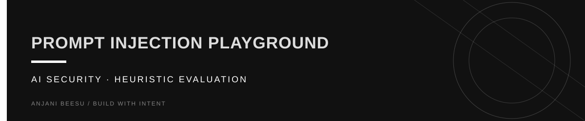

<!-- Visual identity: near-black, warm ivory, and butter yellow. -->

<p align="center">
  
</p>

<p align="right"><sub><a href="https://github.com/AnjaniBeesu">ANJANI BEESU</a> &nbsp; / &nbsp; <a href="https://www.linkedin.com/in/anjanibeesu/">LINKEDIN</a> &nbsp; / &nbsp; <a href="https://portfolio-theta-olive-54.vercel.app/">PORTFOLIO</a></sub></p>

---

# Prompt Injection Playground

An interactive, local-first AI security research tool for studying prompt-injection patterns, testing heuristic detection, and comparing defensive policies.

> **Scope:** This is an educational prototype. Its detector is rule-based, not an LLM judge, and it does not guarantee protection against prompt injection.

## Features

- Analyze text locally in the browser with no API key or external model call.
- Assign a weighted 0–100 heuristic risk score and explain triggered signals.
- Compare Monitor, Balanced, and Strict decision policies.
- Explore example attack patterns and benign prompts.
- Run a small labeled benchmark and inspect accuracy, precision, recall, and the confusion matrix.
- Review the implementation and limitations transparently.

## Tech stack

- Next.js 15, React 19, TypeScript
- Tailwind CSS v4
- Client-side, rule-based detector

## Run locally

Requirements: Node.js 20 or newer.

```bash
cd prompt-injection-playground
npm install
npm run dev
```

Open http://localhost:3000.

## Architecture

```text
Text input
   ↓
Pattern and signal detection
   ↓
Weighted risk score + explanations
   ↓
Defense policy threshold
   ↓
Allow / block recommendation
```

## Evaluation notes

The included benchmark is a small, fixed educational dataset. Its metrics describe performance only on those examples; they should not be interpreted as real-world detection rates. The rules can miss novel or obfuscated attacks and may flag benign text that discusses attacks.

## Security and privacy

Analysis runs locally in the browser; the app does not send submitted text to an LLM or backend. Avoid entering secrets into any public demo regardless.

## Roadmap

- Add a larger, versioned evaluation corpus with documented labeling criteria.
- Add regression tests for false positives and false negatives.
- Add optional model-assisted evaluation behind explicit user consent.
- Track performance by attack category and defense policy.

## License

MIT
